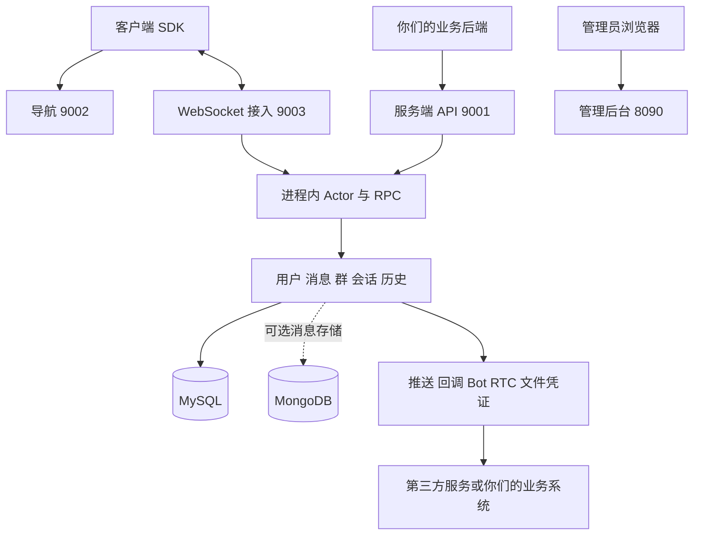
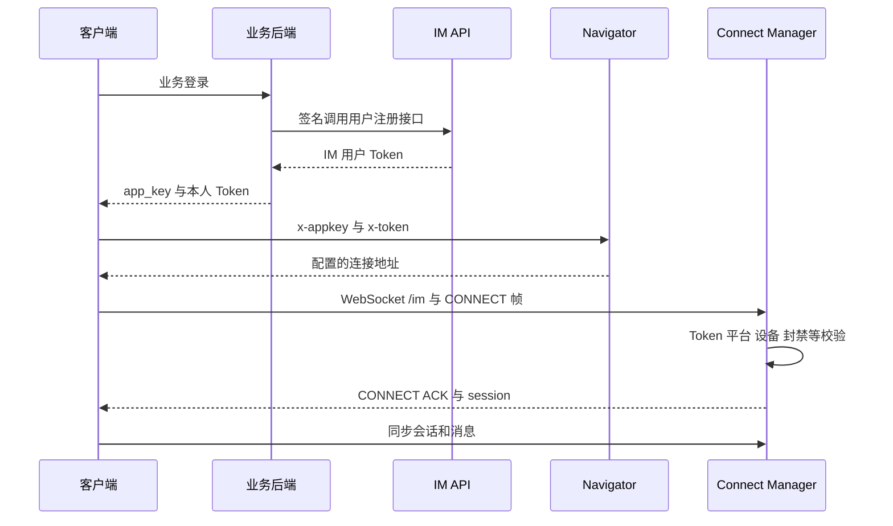
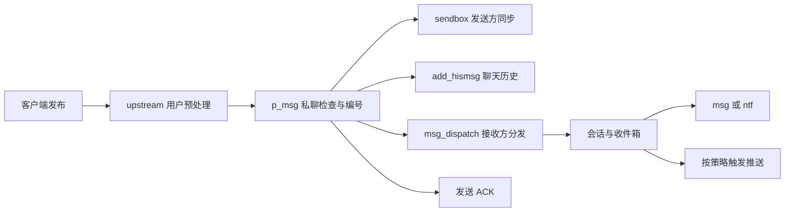

# im-server 项目导读与维护指南

本项目是一套 Go 编写的即时通讯后端，负责客户端连接、消息分发、离线同步、聊天历史、会话、群组及相关扩展能力。对接业务系统时，业务后端负责自己的登录和权限，再通过 IM 服务端 API 注册 IM 用户、管理关系、发消息；客户端使用 IM Token 和 SDK 收发消息。

当前维护仓库为 **[bitcomputing/im-server](https://github.com/bitcomputing/im-server)**，源自 JuggleIM。本文面向接手开发和维护的工程师，以本地源码提交 `cb7297860c9e3064956274d75775cbd2a2f4c060` 为基线，整理日期为 2026 年 11 月 2 日。这里介绍的是当前仓库的社区版实现。

## 阅读路线

第一次阅读建议分三轮：

1. **建立全貌**：先读第 1～4 节，理解产品边界、目录、端口和启动过程。
2. **理解核心**：读第 5～9 节，跟一遍登录、发消息、离线同步、数据存储和鉴权。
3. **准备接手**：读第 10～16 节，搭建环境、定位修改入口、建立验收方式。

目录：

- [1 项目定位与能力边界](#1-项目定位与能力边界)
- [2 技术栈与代码地图](#2-技术栈与代码地图)
- [3 系统结构和对外入口](#3-系统结构和对外入口)
- [4 从启动入口理解运行时](#4-从启动入口理解运行时)
- [5 登录和连接流程](#5-登录和连接流程)
- [6 一条私聊消息如何流转](#6-一条私聊消息如何流转)
- [7 群聊与离线同步](#7-群聊与离线同步)
- [8 数据模型与存储](#8-数据模型与存储)
- [9 配置和信任边界](#9-配置和信任边界)
- [10 本地运行与最小验收](#10-本地运行与最小验收)
- [11 扩展能力如何接入](#11-扩展能力如何接入)
- [12 二次开发从哪里改](#12-二次开发从哪里改)
- [13 测试和性能验证](#13-测试和性能验证)
- [14 日常排障路线](#14-日常排障路线)
- [15 fork 后的维护重点](#15-fork-后的维护重点)
- [16 源码阅读顺序与术语](#16-源码阅读顺序与术语)

## 1 项目定位与能力边界

### 1.1 三层职责

| 层次 | 负责什么 | 与本仓库的关系 |
| --- | --- | --- |
| 你们自己的业务系统 | 账号、登录、业务权限、产品规则，以及何时创建群或发送通知 | 通过 HTTP 服务端 API 对接 |
| IM 核心 | 长连接、消息路由、同步、历史、会话、群和用户等 IM 数据 | 本仓库主体 |
| 客户端 SDK 与 UI | 协议编解码、连接管理、同步、聊天界面 | 大部分在其他仓库，协议改动需要一起考虑 |

例如，“用户是否有权进入某客服群”属于你们的产品规则；“把这个用户加入 IM 群并接收群消息”属于 IM 的执行能力。调用服务端 API 的业务后端需要先完成自己的授权判断。

### 1.2 当前代码中的主要能力

- 私聊、群聊、系统消息、广播及群定向消息。
- 多端连接、离线同步、会话列表、未读数、置顶、免打扰和会话标签。
- 历史查询、消息撤回、删除、修改、已读、引用、合并和收藏等消息能力。
- 用户注册和资料、好友关系、拉黑、封禁、设备绑定与在线状态订阅。
- 第三方离线推送、对象存储上传凭证、事件回调、内容拦截、机器人和 RTC 房间信令。
- 多租户配置、管理后台、运行日志、性能指标和压测工具。

能力是否对某个应用生效，还受应用设置、消息 Flags、客户端 SDK 和外部服务配置影响。不能仅凭存在某个结构体或枚举判断功能已经完整开放。

### 1.3 接手前必须明确的边界

**部署单位是一个 Go 进程。** `services/` 下的名称代表模块，并不代表每个模块是一个独立部署的微服务。默认 Compose 只有 MySQL 和 im-server 两个容器。

**当前社区版没有实现跨节点路由。** [Cluster 实现](../commons/gmicro/cluster.go)的 `GetAllNodes()` 只返回本节点，`GetTargetNode()` 也只查本节点的方法。直接增加多个容器不能自动获得共享连接状态、跨节点投递或故障转移。

**管理后台和聊天 Demo 通过 Go 依赖集成进来。** [启动器](../launcher/main.go)调用 `RouteJuggleChat()`；[AdminGateway](../services/admingateway/starter.go)加载上游 console 的路由和前端资源。因此本项目运行时还包含关联项目的代码，后台和 Demo 的完整源码不在本仓库。

**RTC 侧主要负责信令和授权。** 音视频媒体由配置的 RTC 服务承载，不应把 IM 服务当成已经部署好的媒体服务器。

**直播聊天室和公共频道需要单独确认。** 公共协议和辅助函数中存在相关类型，但当前 Starter 中未注册 `c_msg`、`pc_msg` 处理器。不要据 README 的生态描述就将其视为本版本可直接验收的独立功能。

## 2 技术栈与代码地图

### 2.1 主要技术栈

以下版本取自当前 [go.mod](../go.mod)，用于识别项目依赖，不代表版本升级建议。

| 技术 | 当前用途 |
| --- | --- |
| Go `1.25.12` | 模块声明的工具链版本；根 Dockerfile 也使用这个版本 |
| Gin `v1.12.0` | 服务端 API、导航和管理相关 HTTP 路由 |
| Gorilla WebSocket `v1.5.1` | 客户端长连接 |
| Protobuf | WebSocket 协议、业务消息、进程内 RPC 信封 |
| 自建 `gmicro` 与 Tunny | Actor 分发、执行池、回调和超时 |
| GORM `v1.31.1`、MySQL | 主数据库和默认消息存储；Compose 使用 MySQL 8.0 |
| MongoDB Driver | 可选消息、历史和推送数据存储实现 |
| LevelDB | 可选本地 KV／时序类数据，默认放在日志目录下的 `kvdb_data` |
| LRU、分段锁、工作池 | 本地缓存、序号保护和按用户调度 |

`go.mod` 中出现 Redis、NATS 等间接依赖，不表示基础 IM 部署必须单独运行这些服务。当前 Compose 的必需依赖以实际启动配置和源码为准。

### 2.2 顶层目录

| 路径 | 阅读时关注什么 |
| --- | --- |
| [launcher](../launcher/) | `main.go` 入口、运行配置、构建与容器启动脚本 |
| [services](../services/) | IM 业务模块，是日常开发主要区域 |
| [commons](../commons/) | Actor、RPC、配置、数据库、协议、缓存、日志和通用工具 |
| [sql](../sql/) | 新数据库初始化结构；主入口为 `imserver.sql` |
| [docker](../docker/) | Compose 配套初始化数据，例如导航返回的连接地址 |
| [simulator](../simulator/) | 模拟客户端、集成测试和基准测试逻辑 |
| [cmd/jimbench](../cmd/jimbench/) | 压测 CLI |
| [examples](../examples/) | 服务端 API 接入示例 |
| [scripts](../scripts/) | 压测、推广指标等脚本；并非全部属于 IM 运行链路 |
| [.github](../.github/) | CI、依赖更新、Issue 模板和上游推广自动化 |
| [docs](./) | 架构、部署排障、API 快速开始与专题资料 |
| [testmain](../testmain/) | 辅助测试入口；正常启动从 `launcher` 开始 |

### 2.3 业务模块地图

| 模块 | 职责与典型入口 |
| --- | --- |
| [apigateway](../services/apigateway/) | 可信业务后端调用的 HTTP API；从 `routers/router.go` 找接口 |
| [navigator](../services/navigator/) | Token 校验、下发连接地址、客户端日志上传 |
| [connectmanager](../services/connectmanager/) | WebSocket、连接上下文、心跳、登录、踢人和下行消息 |
| [admingateway](../services/admingateway/) | 集成上游管理后台；本地 `starter.go` 主要是装配 |
| [usermanager](../services/usermanager/) | 用户资料和设置；`upstream` 还是上行消息预处理入口 |
| [message](../services/message/) | 私聊、收发箱、离线同步、按用户分发、ACK 和推送触发 |
| [group](../services/group/) | 群资料、成员、禁言、群消息检查和成员扇出 |
| [conversation](../services/conversation/) | 会话列表、未读、置顶、免打扰、标签和会话配置 |
| [historymsg](../services/historymsg/) | 持久化历史、查询、撤回、已读、修改、删除、收藏、合并消息 |
| [friendmanager](../services/friendmanager/) | 好友关系、备注及关系变化 |
| [broadcast](../services/broadcast/) | 广播和群发相关处理 |
| [pushmanager](../services/pushmanager/) | APNs、FCM、Android 厂商等推送通道与设备 Token |
| [fileplugin](../services/fileplugin/) | 文件存储配置与上传凭证，不是通用文件服务器 |
| [subscriptions](../services/subscriptions/) | 向业务系统发送消息、上下线事件回调 |
| [statussubscriptions](../services/statussubscriptions/) | 用户状态订阅关系与通知 |
| [sensitivemanager](../services/sensitivemanager/) | 敏感词管理、文本过滤，与通用拦截器配合 |
| [botmsg](../services/botmsg/) | 机器人消息、机器人会话及外部 Bot 引擎 |
| [rtcroom](../services/rtcroom/) | 房间、成员、邀请、接听、挂断及第三方 RTC 授权 |
| [logmanager](../services/logmanager/) | 消息和连接日志、管理侧日志查询支撑 |
| [commonservices](../services/commonservices/) | 跨模块辅助方法、应用配置缓存、消息 Flags、Token、统计与拦截器 |

典型模块组织是 `starter.go → actors/ → services/ → storages/或dbs/`。并非所有模块都完全一致；例如群组直接使用 `dbs/`，消息模块则提供 MySQL/MongoDB 存储工厂。

## 3 系统结构和对外入口



| 监听端口 | 典型路径 | 用途 |
| --- | --- | --- |
| `9001` | `/apigateway/users/register` 等 | 服务端 API；根路径 `GET /`、`HEAD /` 可作简单存活检查 |
| `9002` | `/navigator/general` | 导航；需要显式启用 `navGateway.httpPort` |
| `9003` | `/im`、`/imbot`、`/im/publish` | SDK WebSocket、Bot 连接与 HTTP 发布入口 |
| `9003` | `/health`、`/version`、`/metrics` | 存活、代码内版本字符串、JSON 指标快照 |
| `9003` | `/jim/` 和 `/` | 启动器集成的聊天 Demo API／页面，取决于其初始化成功 |
| `8090` | `/admingateway/` 和管理页面 | 上游 console 的管理 API 与 Web UI |
| `6060` | `/debug/pprof/` | Go 诊断，由启动器单独启动 |

SDK 配置里常见的 `ws://127.0.0.1:9003` 是服务基础地址；直接操作原始 WebSocket 时，对应处理器路径是 `/im`，还必须发送项目定义的二进制 Protobuf 协议。HTTP 返回正常不等于 SDK 已登录成功。

`/metrics` 返回 JSON，不是可以直接当作 Prometheus 文本暴露格式使用的接口。`/version` 当前返回硬编码的 `1.8.16`，定位部署版本时应同时记录实际 Git 提交和镜像版本。

依据：[WebSocket 服务](../services/connectmanager/server/imwebsocketserver.go)、[共享 HTTP Mux](../services/commonservices/defaulthttpserver.go)、[导航 Starter](../services/navigator/starter.go)。

## 4 从启动入口理解运行时

### 4.1 启动顺序

[launcher/main.go](../launcher/main.go)是最值得先读的文件：

1. 在后台启动 `6060` 诊断服务。
2. 读取配置，默认路径为当前工作目录下的 `conf/config.yml`。
3. 初始化日志、MySQL，并执行 `dbcommons.Upgrade()`。
4. 根据配置打开本地 KV；选择 MongoDB 引擎时连接 MongoDB 并注册集合。
5. `bases.InitImServer()` 创建本地 Actor 运行时并记录各网关端口。
6. 创建共享 HTTP Mux，尝试装配 JuggleChat Demo。
7. 用 `imstarters.Loaded()` 加载各模块并注册 Actor 方法。
8. 启动性能采集、各模块监听器和用户活跃数据清理任务。
9. 等待退出信号，调用模块 Shutdown 和部分后台任务停止逻辑。

这里存在“进程运行，但某个子入口未成功启动”的可能：部分模块启动失败会输出错误并返回，HTTP 监听又在 goroutine 中启动。验收时应分别检查需要使用的端口和业务链路。

### 4.2 Actor 和 RPC 怎么理解

调用方通过方法字符串定位能力，例如 `upstream`、`p_msg`、`g_msg`、`msg_dispatch`、`sync_msgs`、`qry_convers`。方法在模块的 `starter.go` 注册。

请求被包装成 `RpcMessageWraper`，携带 `AppKey`、`RequesterId`、`TargetId`、会话、请求序号、QoS 和 Protobuf 业务数据。`bases.SyncRpcCall` 等方法提供等待结果的调用；异步调用负责提交工作，结果不会自动形成跨模块事务。

需要同时读三个层次：

- [commons/bases](../commons/bases/)：上下文、信封、调用与业务 Actor 包装。
- [commons/gmicro/cluster.go](../commons/gmicro/cluster.go)：当前节点及路由。
- [commons/gmicro/actorsystem](../commons/gmicro/actorsystem/)：方法注册、执行池、回调和超时。

**Actor 名称本身不保证按用户串行执行。** 通用 Actor 执行器允许并发；消息下行另在 [dispatchservice.go](../services/message/services/dispatchservice.go) 中按 `appkey + receiverId` 进入 `SinglePools`，会话消息序号另由 [msgconvercache.go](../services/commonservices/convercache/msgconvercache.go) 的分段锁保护。改动顺序或并发行为时，应检查具体路径的锁和队列。

模块间主要使用 RPC，但源码也存在直接依赖，例如 `commonservices/convercache` 读取会话、历史存储，消息分发调用 `botmsg/botclient`。因此修改公共包仍需评估真实 import 关系。

## 5 登录和连接流程



导航读取 `globalconfs` 中的 `connect_address`，根据节点配置和默认地址组成响应。这里配置的是**客户端能访问的地址**，不是数据库地址或容器内部服务名。手机访问时，`127.0.0.1` 指手机自身。

连接成功后，系统维护用户、设备、平台和 session 的连接上下文，并注册推送 Token、触发在线状态处理。业务心跳与 WebSocket Ping/Pong 用于发现失效连接；连接关闭还会更新离线状态。

源码入口：[导航鉴权](../services/navigator/apis/checktoken.go)、[导航响应](../services/navigator/apis/navi.go)、[登录检查](../services/connectmanager/services/logincheck.go)、[协议监听器](../services/connectmanager/server/imlistener.go)、[连接管理](../services/connectmanager/services/connectmanager.go)。

## 6 一条私聊消息如何流转

### 6.1 从客户端发布到接收者

以 Alice 给 Bob 发持久化文本消息为例：

1. SDK 将消息编码成发布帧，Topic 为 `p_msg`，载荷为 `UpMsg`。
2. Connect Manager 把消息送往 `usermanager` 的 `upstream` Actor。
3. `UpstreamActor` 补充发送者资料，检查适用的全局禁言设置，确定真实方法及目标。
4. `PrivateMsgActor` 调用 `SendPrivateMsg()`：执行内容拦截、拉黑和可选好友校验，分配消息 ID／序号，并按 `ClientUid` 过滤近期重复请求。
5. 向 `sendbox` 提交发送方同步工作；符合持久化标记的消息向 `add_hismsg` 提交历史保存；按配置发起订阅事件。
6. 向 `msg_dispatch` 提交 Bob 的下行工作。私聊的接收视角中，会话目标是 Alice，因此发送方和接收方消息里的 `TargetId` 不一定相同。
7. 分发模块处理会话设置、未读等信息，按条件写入接收箱、更新会话，再通过 `msg` 下发完整消息或通过 `ntf` 通知客户端同步。推送策略同时参与判断。
8. `PrivateMsgActor` 返回发送 ACK；接收端的投递 ACK 和用户已读操作另行处理。



图中的分支包含异步提交，不表示这些操作在同一个数据库事务里依次完成。

### 6.2 四种容易混淆的成功状态

| 结果 | 可以说明什么 | 不能据此推断什么 |
| --- | --- | --- |
| HTTP 发消息 API 返回 `code: 0` 和 `msg_id` | 接口已处理请求并安排后续发送工作 | 内容检查、持久化和接收者投递都已完成 |
| WebSocket 发送 ACK 成功 | 发送处理路径给出了成功结果 | 所有异步写库均成功、所有设备均收到 |
| 接收端投递 ACK | 对应下行协议得到确认 | 用户已经看过内容 |
| 已读操作／回执 | 执行了业务上的已读更新 | 等同于任意一种网络 ACK |

这个区别直接来自源码：[HTTP 私聊接口](../services/apigateway/apis/msg.go)在 goroutine 中调用异步发送并先返回响应；[Save2Sendbox](../services/commonservices/msgservice.go)与 [SaveHistoryMsg](../services/commonservices/historyservice.go)也使用无等待路由。

应用若需要“最终已送达”或“已读”的业务判断，应结合相应状态和回执，不能仅依赖 HTTP 成功响应。

### 6.3 消息字段和 Flags

| 字段 | 含义 |
| --- | --- |
| `MsgType` | 如 `jg:text`，决定消息的业务类型及客户端展示方式 |
| `MsgContent` | 业务载荷；HTTP 层常用 JSON 字符串，内部是字节数据 |
| `ClientUid` | 客户端消息标识，用于当前进程的近期去重 |
| `MsgId` | 服务端消息标识，用于历史查询、撤回等操作 |
| `MsgSeqNo` | 会话中的消息序号；持久化标记参与序号生成 |
| `ChannelType`、`SubChannel` | 会话类型及子频道，参与存储和缓存定位 |
| `LifeTime`、`LifeTimeAfterRead` | 消息生命周期相关设置，需结合历史处理及 SDK 行为理解 |

Flags 是位组合，核心定义见 [msgflag.go](../services/commonservices/msgdefines/msgflag.go)：`1` 命令、`2` 计数、`4` 状态、`8` 存储、`32` 合并、`64` 免打扰、`1024` 流式、`2048` 加密标记。API 普通发消息的默认标记包含计数和存储，即 `2 | 8`。这些值影响历史、未读、同步和推送路径，新增消息类型时必须明确期望。

去重缓存是容量 `10000`、读取超时 `10 分钟`的进程内 LRU，键直接使用 `ClientUid`。客户端应生成足够唯一的 ID；进程重启、缓存淘汰或超时后，不具备持久化去重保证。源码：[msgfilter.go](../services/commonservices/msgfilter.go)。

## 7 群聊与离线同步

### 7.1 群消息比私聊多了什么

群消息经 `upstream → g_msg → GroupMsgActor → SendGroupMsg()` 处理。客户端来源的群消息会检查成员身份、成员禁言、群禁言、白名单和相关频率限制，然后经过内容拦截、编号、发送箱／历史提交和成员分发。

**服务端 API 来源会跳过该函数中的成员与禁言检查块**，这是可信后端与普通客户端的权限差异。产品后端应自行决定哪些用户或管理操作允许使用这条高权限路径。

群历史围绕群会话保存；下行会按成员 ID 扇出。指定 `ToUserIds` 时还会按目标成员过滤。群规模、在线比例和推送策略会显著放大或缩小实际工作量。

两类阈值不要混用：

- `GrpMsgThreshold`：群发送分发队列的调度阈值，代码默认 `10000`；达到阈值后会进入分级延迟队列，队列中的消息超过 60 秒会被该实时分发路径丢弃并记录日志。
- `BigGrpThreshold`：接收者分发的大群策略阈值，应用默认 `1000`；超过阈值时会针对离线成员及 `ForceCloseOfflineMsg` 设置选择不同路径，可能只批量更新会话而不逐人写收件箱和触发普通投递。

因此群消息测试必须覆盖大小群、在线／离线成员、禁言和定向消息，不能把“单人私聊通过”当成群聊可靠性的证据。

源码：[群消息服务](../services/group/services/groupmsgservice.go)、[群分发队列](../services/group/services/dispatchservice.go)、[接收者分发](../services/message/services/dispatchservice.go)。

### 7.2 离线同步与历史查询分别解决什么

| 机制 | 解决的问题 | 主要入口 |
| --- | --- | --- |
| 收件箱 Inbox | 用户离线期间需要补收哪些消息或命令 | `sync_msgs`、`inboxmsgs`、`cmdinboxmsgs` |
| 发件箱 Sendbox | 发送者其他设备需要同步哪些操作 | `sendboxmsgs`、`cmdsendboxmsgs` |
| 会话列表 | 聊天列表、最新消息、未读、置顶、免打扰 | `conversation` |
| 聊天历史 | 打开某个会话后分页看以前的消息 | `historymsg`、`p_hismsgs`、`g_hismsgs` |

`SyncMessages()` 根据收件箱／发件箱同步游标、保留时间和内存队列组合结果，并限制批量数量。同步游标不是“全库历史分页位置”。历史查询和离线补收是两套路径，验收时要分别测试。

应用默认设置中，普通离线消息保留为 **10 分钟**、离线命令为 **10080 分钟（7 天）**、历史为 **180 天**。其中 10 分钟来自 `AppInfo` 默认字段，不能只看全局 `MsgExpired` 的 24 小时兜底常量；实际行为受应用配置和相应清理实现控制。

源码：[同步服务](../services/message/services/syncmsgservice.go)、[收发箱保存和清理](../services/message/services/messagesave.go)、[应用默认设置](../services/commonservices/appinfocache.go)。

## 8 数据模型与存储

### 8.1 三种存储的角色

MySQL 是必需依赖，存应用、用户、关系、配置等数据，默认也存消息。`msgStoreEngine: mongo` 只切换已经提供 MongoDB 实现的存储工厂，不会把整个系统搬到 MongoDB。

LevelDB 是进程内嵌入式存储，可由 `kvdb.isOpen` 开关控制。默认目录为 `<logPath>/kvdb_data`。它和 MySQL 数据卷是两份不同的数据资产。

切换 `msgStoreEngine` 不是数据迁移命令：旧数据库里的历史不会因为改了配置就自动复制到新引擎。具体支持哪些集合，应查看各模块的 `storages/storage.go`。

### 8.2 主要表分组

| 数据领域 | 代表性表 | 阅读重点 |
| --- | --- | --- |
| 租户与管理 | `apps`、`appexts`、`accounts`、`accountapprels`、`globalconfs` | 应用设置、管理账号、全局配置与 schema 版本 |
| 用户与关系 | `users`、`userexts`、`friendrels`、`blocks`、`banusers`、`binddevices` | 同一个用户 ID 必须结合 `app_key` 理解 |
| 群 | `groupinfos`、`groupmembers`、`groupinfoexts`、`groupmemberexts`、`grpsnapshots` | 群资料、成员、禁言／设置、快照 |
| 会话 | `conversations`、`globalconvers`、`converconfs`、`userconvertags`、`convertagrels`、`mentionmsgs` | 用户视角的聊天列表与全局会话信息不同 |
| 同步箱 | `inboxmsgs`、`sendboxmsgs`、`cmdinboxmsgs`、`cmdsendboxmsgs`、`brdinboxmsgs` | 接收／发送方向、命令类型及保留时间 |
| 历史 | `p_hismsgs`、`g_hismsgs`、`s_hismsgs`、`bc_hismsgs`、`gc_hismsgs` | 私聊、群、系统、广播和群发历史 |
| 历史辅助 | `readinfos`、`p_delhismsgs`、`g_delhismsgs`、`mergedmsgs`、`favoritemsgs`、`topmsgs` | 已读、用户删除视图、合并、收藏和置顶消息 |
| 扩展 | `fileconfs`、`pushtokens`、`ioscertificates`、`androidpushconfs`、`interceptors`、`sensitivewords` | 外部能力配置与凭据所在范围 |
| RTC 与 Bot | `rtcrooms`、`rtcmembers`、`botconvers` | 房间成员状态及机器人会话 |
| 观测 | `performance_metrics`、`msgstats`、`msgrealtimestats`、`useractivities`、`clientlogs` | 指标、活跃统计与客户端日志 |

完整结构以 [sql/imserver.sql](../sql/imserver.sql) 和 [增量 SQL](../commons/dbcommons/sqls/) 为准。表名或旧协议中存在某项能力，仍要结合 Starter 和真实调用路径判断它是否可用。

### 8.3 定位一条业务数据

用户会话常以 `app_key + user_id + target_id + sub_channel + channel_type` 区分。私聊内部会话 ID 通过排序双方用户 ID 后用 `:` 拼接；群会话通常以群 ID 为目标。

查询时不要丢失租户、子频道或会话类型，也不要把“用户眼中的对方 ID”和“内部会话 ID”当成完全相同的字段。见 [GetConversationId](../services/commonservices/conversationservice.go) 和 SQL 唯一索引。

### 8.4 初始化和升级

新库使用 `sql/imserver.sql` 初始化；当前文件会写入 `globalconfs.jimdb_version = 20260908`。已有数据库启动时由 `dbcommons.Upgrade()` 读取版本，按日期顺序执行更高版本的嵌入 SQL。

新增表字段时，需要考虑“老库增量升级”和“新库直接初始化”两条路径，并保持结构、版本一致。该升级实现不是整批事务回滚机制；某个脚本失败时会打印错误，外层仍可能继续尝试后续版本。部署前应在数据库副本演练，并检查每个迁移结果与最终版本。

依据：[数据库初始化](../commons/dbcommons/dbmanager.go)、[迁移逻辑](../commons/dbcommons/dbmigration.go)、[LevelDB 初始化](../commons/kvdbcommons/kvdbmanager.go)。

## 9 配置和信任边界

### 9.1 配置分三层

| 层次 | 来源 | 代表配置 |
| --- | --- | --- |
| 进程配置 | `launcher/conf/config.yml` 或 `-config` 指定文件 | 数据库、端口、日志、消息引擎、KV、性能采集 |
| 全局运行配置 | MySQL `globalconfs` | `connect_address`、数据库版本等 |
| 应用配置 | `apps`、`appexts` 及相关功能表 | Token 有效期、好友校验、保存周期、推送、RTC、Bot、拦截器 |

容器通过 [run.sh](../launcher/scripts/run.sh) 将环境变量替换进 [config_template.yaml](../launcher/scripts/config_template.yaml)，再生成 `/opt/conf/config.yml`。源码启动则直接读取配置文件；不要假设全部进程配置都能自动被任意环境变量覆盖。

特别注意：

- 本地配置中的 `defaultPort` 不在当前 `ImConfig` 字段定义内，实际监听应看各网关端口。
- 本地已跟踪的 `launcher/conf/config.yml` **没有** `navGateway`，而配置加载器也未为它补默认端口；需要自行添加 `navGateway.httpPort: 9002`。Compose 模板已经包含该项。
- 本地样例数据库名是 `im_db`，Compose 和初始化示例使用 `jim_db`。必须把建库、导入 SQL、进程配置中的名称统一。
- `performanceMetrics.isOpen` 控制定时入库采集，默认配置未开启；`/metrics` 快照接口是另一件事。
- 应用和全局配置有本地缓存。直接改库后不一定立即生效，应查对应缓存刷新机制。

### 9.2 三套身份不要混用

| 身份 | 使用位置 | 凭据 |
| --- | --- | --- |
| 管理员 | 管理 API 和后台 | 管理账号登录后的授权 |
| 可信业务服务器 | `/apigateway/*` | `appkey`、`nonce`、`timestamp`、`signature` |
| 终端用户 | Navigator 和 WebSocket | 对应应用、用户的 IM Token |

服务端 API 当前签名为 `SHA1(app_secret + nonce + timestamp)`。Token 则使用应用的 `AppSecureKey` 解析和校验，具体格式由项目自己的 Token 实现定义。两者用途不同。

客户端只能拿本人 Token 和所需连接信息；`app_secret`、管理授权、第三方服务密钥留在可信后端。Token 有效期由应用 `TokenEffectiveMinute` 控制；值为 `0` 时当前检查逻辑不执行时间过期判断，不能默认它是短期 Token。

当前 API 签名中间件检查字段和摘要，但未在该中间件实现时间窗口与 nonce 重放记录。正式对外开放时，应结合可信网络边界、TLS 和业务授权评估调用方式。管理、MySQL、pprof 等入口也应按真实使用者限制访问。

源码：[API 签名](../services/apigateway/apis/signature.go)、[Token 实现](../services/commonservices/tokens/token.go)、[应用设置](../services/commonservices/appinfocache.go)。这部分是对当前实现边界的说明，不代替完整安全审计。

## 10 本地运行与最小验收

### 10.1 优先用 Docker Compose 建立基线

在仓库根目录执行；PowerShell 可直接运行以下 Docker 命令：

```powershell
docker compose config --quiet
docker compose up -d --build
docker compose ps
docker compose logs --tail 100 im-server
```

新同事克隆时使用 `https://github.com/bitcomputing/im-server.git`。首次构建需要拉取镜像和 Go 依赖；MySQL 的初始化 SQL 仅在新数据目录创建时执行。

默认本地地址：

- 管理后台：`http://127.0.0.1:8090`，样例账号 `admin / 123456`。
- API 存活：`http://127.0.0.1:9001/`。
- 导航存活：`http://127.0.0.1:9002/`。
- 连接服务存活：`http://127.0.0.1:9003/health`。

```powershell
curl.exe -f http://127.0.0.1:9001/
curl.exe -f http://127.0.0.1:9002/
curl.exe -f http://127.0.0.1:9003/health
```

Compose 只为 MySQL 定义了健康检查，im-server 的 `running` 状态不等于全部业务已就绪。上述检查也只证明 HTTP 路径工作，还需要下一步验证。

### 10.2 走通服务端 API 再接 SDK

仓库已有 [server-api-quickstart.sh](../examples/server-api-quickstart.sh)：登录管理 API → 创建测试应用 → 注册 Alice、Bob → 调用私聊发送接口。它会输出测试用户 Token 和消息 ID，不输出应用密钥。

在具备 `bash`、`curl`、`jq`、`openssl` 的环境中运行：

```bash
bash examples/server-api-quickstart.sh
```

Windows 可使用已配好这些工具的 Git Bash 或 WSL；普通 PowerShell 不直接执行 Bash 脚本语法。管理 API 创建应用需要先登录，优先参照此脚本，不要只复制 README 中省略授权的独立请求片段。

这一步验证的是服务端 API 流程。随后用匹配平台的客户端 SDK，分别以 Alice、Bob 的 Token 连接服务，至少验收：

1. 双方登录成功，Alice 发消息后 Bob 实际收到。
2. Bob 离线后发消息，Bob 重连能在配置保留窗口内补收。
3. 打开会话能查询历史；历史与离线同步结果符合消息 Flags。
4. 已读后未读数正确，多设备同步符合预期。
5. 创建群、加入成员、发群消息和离线重连正常；再验证退群／禁言场景。

建议每条验收记录保存应用、用户、群、`msg_id`、时间、客户端结果和对应日志定位信息。不要将真实凭据写入共享报告。

### 10.3 源码开发方式

准备 `go.mod` 所需工具链和 MySQL 8。可在 MySQL 客户端中创建开发数据库并导入 SQL：

```sql
CREATE DATABASE IF NOT EXISTS jim_db CHARACTER SET utf8mb4 COLLATE utf8mb4_0900_ai_ci;
USE jim_db;
SOURCE D:/ClaudeCodeProjects/im-server/sql/imserver.sql;
```

`SOURCE` 路径换成你的实际 checkout。它适用于新开发库；不要对已有业务库重复导入整份初始化结构。

编辑 `launcher/conf/config.yml`，确保至少包含正确的数据库配置及端口。下面的片段只展示需要核对的字段，密码替换为开发库实际值：

```yaml
msgStoreEngine: mysql
mysql:
  user: root
  password: "<开发库密码>"
  address: 127.0.0.1:3306
  name: jim_db
apiGateway:
  httpPort: 9001
navGateway:
  httpPort: 9002
connectManager:
  wsPort: 9003
adminGateway:
  httpPort: 8090
```

手动初始化还需配置 `connect_address`，格式参考 [Docker 初始化 SQL](../docker/mysql-init/02-connect-address.sql)。如果复用 Compose 的 MySQL，要使用其实际数据库密码与映射端口，并先停止 Compose 中的 im-server，避免监听端口冲突。

```powershell
Set-Location launcher
go run .
```

完整构建以 CI 的 Linux 目标为基线。遇到平台相关依赖问题时，可用 Docker 或 WSL 复现 Linux 环境；本文不承诺所有第三方依赖在 Windows 原生环境都已验证。

### 10.4 停止和保留数据

```powershell
docker compose down
```

正常停止时保留 MySQL 命名卷。`down -v` 会删除 Compose 数据卷，只适用于明确要丢弃数据的开发环境。

当前 Compose 仅为 MySQL 配置持久卷，没有为 im-server 的日志、KV 和上传目录配置宿主机持久化。容器重建前应明确这些文件是否需要保留。更换宿主机 WebSocket 映射端口或域名时，还要同步调整导航的 `connect_address`，仅改 `WS_HOST_PORT` 不够。

## 11 扩展能力如何接入

| 能力 | 实现位置 | 接手时要确认 |
| --- | --- | --- |
| 离线推送 | [pushmanager](../services/pushmanager/) | 应用通道配置、证书／密钥、设备 Token、免打扰及后台状态；服务启动不代表各厂商通道已经可用 |
| 图片、文件 | [fileplugin/fileengine](../services/fileplugin/fileengine/) | S3、MinIO、OSS、七牛实现；获取上传凭证后结合 SDK 与存储完成文件传输 |
| 消息和上下线回调 | [subscriptions/services/msgsubservice.go](../services/subscriptions/services/msgsubservice.go) | 应用回调 URL／开关；当前实现有最多 3 次尝试与熔断，接收方应幂等处理 |
| 内容审核 | [commonservices/interceptors](../services/commonservices/interceptors/) | 本地敏感词、外部审核、自定义拦截；结果可拒绝、替换、静默或放行 |
| 机器人 | [botmsg/services/botengines](../services/botmsg/services/botengines/) | Dify、Coze、SiliconFlow、自定义引擎及应用／Bot 配置；另有 Bot 连接和转发路径 |
| 音视频 | [rtcroom/services/rtcservice.go](../services/rtcroom/services/rtcservice.go) | Agora、Zego、LiveKit 的配置、授权及客户端 SDK，媒体服务需另行准备 |
| 翻译 | [commonservices/transengines](../services/commonservices/transengines/) | 翻译引擎配置与密钥，业务触发路径在历史／消息能力中 |

这些模块带来了配置与外部服务依赖，接手时应先选你们产品实际需要的能力逐项联调。

回调重试成功与否目前通过日志反映，不应把这条有限重试链路当成已经提供持久化消息队列和无限补偿。机器人在群内是否响应，也受是否被直接提及等设置影响。

## 12 二次开发从哪里改

### 12.1 按需求定位

| 想修改什么 | 首先阅读 | 常见联动范围 |
| --- | --- | --- |
| 新增服务端 API | [apigateway/routers/router.go](../services/apigateway/routers/router.go)、`apis/`、`models/` | 参数验证、签名上下文、RPC、响应格式、API 示例 |
| 私聊规则 | [message/services/msgservice.go](../services/message/services/msgservice.go) | `upstream`、拦截器、好友／黑名单、两种调用入口 |
| 群权限或消息策略 | [group/services/groupmsgservice.go](../services/group/services/groupmsgservice.go) | 客户端与 API 权限差异、成员缓存、分发及推送 |
| 会话未读或标签 | [conversation](../services/conversation/)、[commonservices/convercache](../services/commonservices/convercache/) | 最新消息、已读索引、历史、缓存和多端同步 |
| 历史查询或撤回 | [historymsg/services](../services/historymsg/services/) | MySQL/MongoDB 实现、权限、同步命令与客户端展示 |
| 新增客户端协议字段 | [appmessages.proto](../commons/pbdefines/appmessages.proto)、[connect.proto](../services/connectmanager/server/connect.proto) | 生成代码、编解码、Actor、模拟器和各端 SDK |
| 推送效果 | [message/services/pushservice.go](../services/message/services/pushservice.go)、[pushmanager](../services/pushmanager/) | 设备绑定、应用配置、厂商 payload、免打扰 |
| 数据表变更 | [dbcommons/sqls](../commons/dbcommons/sqls/)、[sql/imserver.sql](../sql/imserver.sql) | 存储实现、新库初始化、旧库迁移、索引 |
| 管理后台 UI 或 Demo | [admingateway/starter.go](../services/admingateway/starter.go)、[launcher/main.go](../launcher/main.go) | 对应上游依赖仓库、依赖版本及资源构建 |

### 12.2 最小完整修改路线

以新增一项服务端能力为例：先找同类现有接口，沿 `路由 → API 参数 → RPC 方法 → Actor → 领域服务 → 存储` 修改。新增 Actor 后在模块 Starter 注册；只有新增整个模块时才需要修改 Launcher。

每次涉及共享逻辑的修改，检查所有调用入口：客户端协议与服务端 API、私聊与群聊、发送者与接收者、多端与离线、MySQL 与可选 MongoDB。只修改一处 API handler，可能不会影响客户端发消息的同名能力。

协议以 `.proto` 为源，生成 Go 文件不手工维护；扩展字段时保持旧客户端兼容。文档命令、样例配置、模拟器与业务验收案例也属于变更范围。

## 13 测试和性能验证

### 13.1 当前 CI 实际检查什么

[.github/workflows/ci.yml](../.github/workflows/ci.yml)在 `master` 的推送／PR 及手动触发时运行：依赖下载与校验、Go 格式检查、推广指标脚本测试、`go vet -composites=false ./...`、Linux 编译、选定单元测试、govulncheck、Compose 配置和镜像构建。

CI 当前选定的 Go 测试可在仓库根目录按以下方式运行：

```bash
go test ./simulator/benchmark
go test ./services/commonservices/...
go test ./commons/metrics/...
go test ./services/pushmanager/services/httputil
```

这些命令是当前 CI 的测试范围，不等于覆盖全部业务。`simulator/tests` 中有依赖运行中服务和应用配置的集成测试，其他厂商测试也要检查前置条件，不能默认 `go test ./...` 是完全离线、无外部依赖的单元测试集合。

涉及并发调度时，仓库已有 [goroutine 调优说明](./goroutine-tuning.md)及相应测试；修改相关逻辑再运行定向测试和适用的 race 检测。

### 13.2 性能应该怎么读

[BENCHMARKS.md](../BENCHMARKS.md) 和 [jimbench](../cmd/jimbench/main.go)将连接建立、发送 ACK、接收端投递分开统计，并输出延迟分位数、吞吐和环境信息。

```bash
bash scripts/run-benchmark.sh all
```

该脚本会启动测试栈、创建测试应用并发送流量，应仅用于隔离环境；需准备文档列出的 Bash、Go、Docker 及辅助工具。默认规模较小，不能将仓库中的 smoke 结果当作生产容量。

同一群的一条上行消息可能产生多条成员投递，因此“发送条数／秒”和“接收投递条数／秒”必须分别看。评估容量至少同时记录：消息大小、并发连接、发送速率、群规模、在线比例、持久化设置、数据库配置、错误率及 ACK／投递 P95、P99。

工作池数量也不等于吞吐能力。通用 Actor 池可通过 `IM_ACTOR_CALLBACK_WORKERS`、`IM_ACTOR_EXECUTOR_WORKERS` 调整，但 `upstream`、`p_msg`、`msg_dispatch` 还有单独配置的池；不能把调整公共池当成限制整个进程并发。

## 14 日常排障路线

| 现象 | 建议先检查 | 关键源码或资料 |
| --- | --- | --- |
| Docker 起不来 | Compose 展开配置、MySQL 健康、端口占用、容器日志 | [Docker 排障](./docker-troubleshooting_zh.md) |
| API 能访问，SDK 连不上 | 导航是否启动、下发地址能否从客户端访问、`/im` 协议、Token、平台、域名限制 | `navigator`、`connectmanager/services/logincheck.go` |
| API 签名失败 | 应用 Key、Secret、nonce／timestamp 拼接及摘要是否与请求一致 | `apigateway/apis/signature.go` |
| API 返回消息 ID，接收方没消息 | 异步业务日志、禁言／拦截、群成员、接收者状态、分发与收件箱、推送设置 | `upstream → p_msg/g_msg → msg_dispatch` |
| 在线能收，重连后补不到 | 离线保留时间、同步游标、收发箱、大小群策略 | `message/services/syncmsgservice.go` |
| 收到了，但查不到历史 | 存储 Flag、异步写库错误、会话 ID／子频道、历史清理规则 | `commonservices/historyservice.go`、`historymsg` |
| 未读不对或多端不同步 | 计数／存储 Flag、已读更新、会话缓存、同步命令 | `conversation`、`historymsg/services/markreadservice.go` |
| 配置改了没生效 | 改的是进程配置还是应用表、容器模板生成、缓存期限 | `configures`、`appinfocache.go`、`globalconfservice.go` |
| CPU／内存／延迟上涨 | `/metrics`、pprof、goroutine、DB 连接、群扇出、队列和外部回调 | [goroutine 说明](./goroutine-tuning.md)、[压测说明](../BENCHMARKS.md) |
| 升级后出现表字段错误 | `jimdb_version`、每段迁移日志、实际 schema 与初始化文件差异 | `commons/dbcommons/dbmigration.go` |

日志定位优先串联 `appkey`、`user_id`、session、请求序号、Actor method 和 `msg_id`。API 中间件返回 `request-id` 可用于关联请求上下文。跨环节定位时，先确认消息在哪一步停止，再判断是配置、业务拒绝、存储还是投递问题。

性能指标定时入库由 `performanceMetrics.isOpen` 控制，当前实现每分钟采集并保留约 24 小时的数据；长期趋势和告警需要另外安排。简单健康接口不会执行一整条收发消息检查。

## 15 fork 后的维护重点

### 15.1 仓库地址切换的实际范围

本地 `origin` 已指向 `bitcomputing/im-server`。Go 模块名仍是 `im-server`，内部 import 使用 `im-server/...`，因此仅切换 Git 托管组织不需要批量替换 Go import。

不过下列依赖仍指向上游，当前 [go.mod](../go.mod)中包括：

| 上游依赖 | 版本 | 与维护工作的关系 |
| --- | --- | --- |
| `github.com/juggleim/imserver-console` | `v1.0.10` | 后台 API、UI 和相关数据库逻辑 |
| `github.com/juggleim/jugglechat-server` | `v1.1.21` | 启动器集成的聊天 Demo、页面和业务逻辑 |
| `github.com/juggleim/imserver-sdk-go` | `v1.0.16` | 服务端 SDK 依赖 |
| `github.com/juggleim/commons` | `v1.0.18`，间接依赖 | 关联项目公共能力 |

你们维护当前 fork 后，需要明确这些关联项目是继续使用固定上游版本，还是遇到实际修改需求时再接管。移动 Git remote 并不会复制 SDK、后台、Demo 的维护权或源码到当前仓库。

### 15.2 已从当前文件确认的接手事项

| 事项 | 当前事实 | 对维护的影响 |
| --- | --- | --- |
| 配置文件跟踪 | `.gitignore` 有 `**/conf/*.yml`，但 `launcher/conf/config.yml` 已在 Git 跟踪中 | 修改开发密码后仍可能被提交；忽略规则不能撤销已有跟踪 |
| 忽略文件残留 | [.gitignore](../.gitignore)中留有合并冲突标记 | 应在配置整理时清理，便于可靠检查提交范围 |
| 导航默认配置 | 本地配置缺少 `navGateway`，代码不补该端口默认值 | 直接源码启动可能只有其他端口而没有独立导航服务 |
| 配置库名差异 | 本地 `im_db` 与 Compose 的 `jim_db` 不同 | 新同事容易连接错库或初始化错库 |
| 上游品牌与链接 | README、贡献指南、安全报告、镜像标签和推广工作流仍有上游地址 | 独立维护时应决定哪些继续引用来源，哪些迁移到组织资源 |
| 数据迁移 | 升级按脚本推进，不具备整批失败回滚 | 发布前需要副本验证，不能只检查进程已启动 |
| 消息确认 | API 返回、发送 ACK、异步持久化和投递是不同阶段 | 验收要覆盖接收者结果与历史持久化 |
| 单节点状态 | 连接、缓存、去重和路由均有本地进程状态 | 不能直接以复制实例实现高可用 |
| 退出流程 | WebSocket Server 的 `Stop()` 当前为空，多数模块 Shutdown 只做少量处理 | 不应假设重启会排空所有异步队列；需验证重连和重启窗口 |

这些是接手时的事实与待办入口，本次导读没有修改这些实现。

### 15.3 建议的维护顺序

先建立一套可重复的“启动 → 登录 → 私聊 → 群聊 → 离线重连 → 历史 → 已读”开发验收，并记录基线提交；再统一开发配置、组织仓库入口和部署信息。随后按你们实际业务验证重启、数据库错误、外部回调失败与目标负载。

有了这些基线后，再决定是否接管后台、客户端 SDK 或改变部署架构，能更准确地区分项目已有行为和二次开发引入的问题。

### 15.4 替换 43Chat Pro 官方部署的验收条件

团队维护 `bitcomputing/im-server` 的目标，是在此基础上二次开发，最终接替 43Chat Pro 当前使用的 JuggleIM 官方部署。本机已验证私聊、群聊、离线补收和历史查询，结果见[本机部署记录](local-deployment_zh.md)。首次替换应优先保持现有业务后端和已发布客户端的行为兼容。

1. **确认现网基线。** 记录 Pro 实际部署版本、客户端 SDK 版本、启用的回调与推送、峰值连接数，以及可导出的数据范围。业务仓库中存在的方法，仍需结合调用方和现网配置确认是否启用。
2. **用业务调用验证兼容性。** 从 chatbot43 的 `lib/imServiceLib/juggleClient.go` 开始，逐项对照[服务端路由](../services/apigateway/routers/router.go)。例如，业务客户端包含私聊流式消息的 `stream/create` 和 `stream/append`，而当前路由注册的是 `stream/send`。应以一次机器人分段回复验证创建、追加、结束和重试的效果。群解散、登录续连、已读、离线推送和发送前回调也需要用对应业务流程验收。
3. **在隔离环境演练迁移。** 确认现网版本和存储结构后，用获准的副本或导出数据演练。核对租户、用户、群成员和历史消息，使用现有客户端检查登录、历史翻页与离线同步游标。按现网峰值验证连接、投递延迟和重连。
4. **验证切换与回退。** 明确停止旧端写入、同步最后一批数据、切换 API 与导航、客户端重连的顺序。演练回退时核对切换后新发的消息，确保恢复旧入口后仍能查询。兼容性、数据核对及回退演练通过后，再安排生产窗口。

## 16 源码阅读顺序与术语

### 16.1 推荐逐文件阅读顺序

| 顺序 | 文件 | 阅读后应能回答 |
| --- | --- | --- |
| 1 | [launcher/main.go](../launcher/main.go) | 一个进程到底加载了哪些模块和上游组件？ |
| 2 | [configures/configure.go](../commons/configures/configure.go) | 实际支持哪些配置、哪些字段有默认值？ |
| 3 | [apigateway/routers/router.go](../services/apigateway/routers/router.go) | 业务后端有哪些可调用入口？ |
| 4 | [imlistener.go](../services/connectmanager/server/imlistener.go) | SDK 登录和发布如何进入业务处理？ |
| 5 | [upstreamactor.go](../services/usermanager/actors/upstreamactor.go) | 发送者资料、全局禁言和真实目标怎么传递？ |
| 6 | [message/starter.go](../services/message/starter.go)、[privatemsgactor.go](../services/message/actors/privatemsgactor.go) | 方法名怎么映射到处理器，发送 ACK 在哪里产生？ |
| 7 | [msgservice.go](../services/message/services/msgservice.go) | 私聊有哪些校验和异步分支？ |
| 8 | [dispatchservice.go](../services/message/services/dispatchservice.go) | 按用户有序分发、会话、收件箱和推送如何连接？ |
| 9 | [syncmsgservice.go](../services/message/services/syncmsgservice.go) | 重连后根据什么游标和保留时间补消息？ |
| 10 | [groupmsgservice.go](../services/group/services/groupmsgservice.go) | 群成员、禁言及 API 权限差异如何影响消息？ |
| 11 | [historymsg/storages/storage.go](../services/historymsg/storages/storage.go)、[imserver.sql](../sql/imserver.sql) | 业务对象最终怎样落到表或 MongoDB？ |
| 12 | [cluster.go](../commons/gmicro/cluster.go)、[actorexecutor.go](../commons/gmicro/actorsystem/actorexecutor.go) | 当前路由、并发和回调有哪些真实保证？ |

### 16.2 常见术语

| 术语 | 在本项目中的意思 |
| --- | --- |
| `app_key` | 应用／租户标识，贯穿 RPC 和数据访问 |
| session | 一次连接或调用上下文的标识，不能简单等同用户 ID |
| Topic／method | 路由处理名称，例如 `p_msg`、`sync_msgs` |
| Actor | 接受消息并执行处理的运行时单元 |
| `UpMsg`／`DownMsg` | 上行消息／面向接收或同步的下行消息结构 |
| ACK | 协议确认，要区分发送确认和投递确认 |
| QoS | 协议中的确认需求，不能单独推出端到端持久化保证 |
| Inbox／Sendbox | 用户收件／发件同步数据 |
| History | 按会话组织的历史消息数据 |
| Fan-out／扇出 | 一次群发布转换成多位成员的投递工作 |
| Starter | 注册 Actor、启动和关闭一个模块的入口 |

### 16.3 配套资料和验证范围

- [已有架构说明](./architecture_zh.md)：组件关系与架构图；具体并发和异步语义以本文引用的当前实现为准。
- [服务端 API 快速开始](./server-api-quickstart_zh.md)：完整登录、建应用、注册用户和发送示例。
- [Docker 故障排查](./docker-troubleshooting_zh.md)：容器、数据库、端口和数据卷。
- [APNs P8 配置](./apns-p8.md)：iOS 推送专题。
- [性能测试](../BENCHMARKS.md)与 [goroutine 调优](./goroutine-tuning.md)：容量、并发与测试边界。
- [LICENSE](../LICENSE)：仓库所附 Apache License 2.0 文本。

本文依据本地源码、配置、SQL 和 CI 文件整理，关键结论附有源码入口；本次执行了 Compose 配置校验与文档链接检查。未启动完整服务、运行 Go 测试、联调客户端或第三方通道，因此部署步骤和验收清单仍需在目标环境执行，本文不构成运行验收或容量结论。
